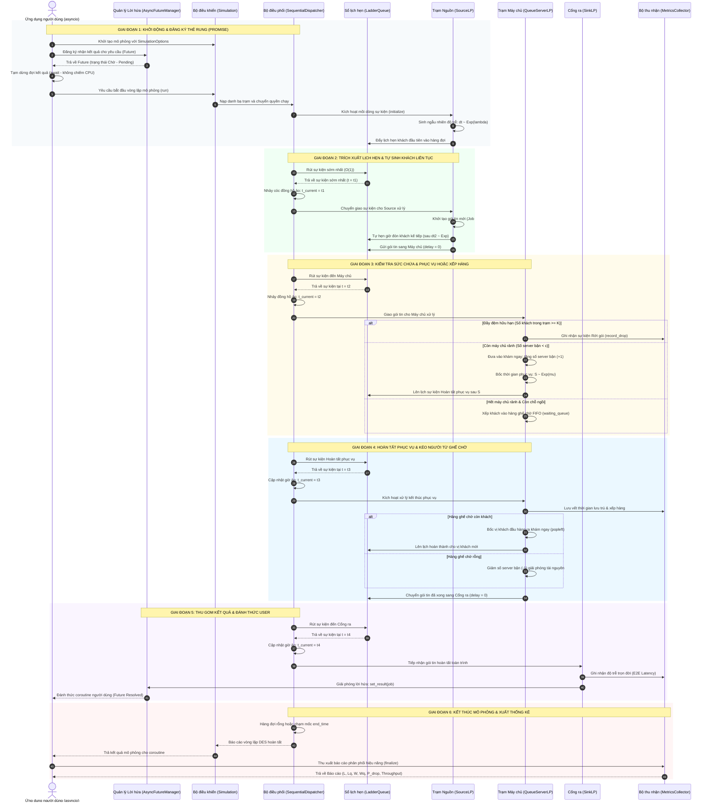

# HƯỚNG DẪN CHI TIẾT KIẾN TRÚC & LUỒNG HOẠT ĐỘNG HỆ THỐNG MÔ PHỎNG (DES & ASYNCIO)
> **Tài liệu trực quan hóa toàn bộ luồng vận hành của gói phần mềm `bkitevsim`**  
> Dành cho việc nắm bắt bản chất nghiệp vụ, bảo vệ đồ án và thuyết trình kỹ thuật.

---

## MỤC LỤC
1. [Bức tranh tổng thể: Hệ thống này đang làm gì?](#buc-tranh-tong-the)
2. [PHẦN 1: BẢN CHẤT CÁC THÀNH PHẦN (Ai làm nhiệm vụ gì?)](#phan-1-ban-chat-cac-thanh-phan)
3. [PHẦN 2: TOÀN BỘ LUỒNG HOẠT ĐỘNG (DIỄN RA NHƯ THẾ NÀO?)](#phan-2-toan-bo-luong-hoat-dong)
4. [BẢNG ĐỐI CHIẾU CHI TIẾT 6 GIAI ĐOẠN NGHIỆP VỤ](#bang-doi-chieu-chi-tiet-6-giai-doan)
5. [PHẦN 3: GIẢI MÃ CÁC ĐIỂM CỐT LÕI (XÓA TAN MỌI MƠ HỒ)](#phan-3-giai-ma-cac-diem-cot-loi)

---

<a name="buc-tranh-tong-the"></a>
## BỨC TRANH TỔNG THỂ: HỆ THỐNG NÀY ĐANG LÀM GÌ?

Để hiểu toàn bộ hệ thống, hãy tưởng tượng một **Phòng khám Bác sĩ thông minh** (hoặc một **Quầy phục vụ Ngân hàng**):

* **Bệnh nhân đến khám (Gói tin / `Job`):** Mang theo mã số bệnh nhân và thời điểm bắt đầu tới.
* **Cửa phát số tự động (Trạm Nguồn - `SourceLP`):** Tự động cấp số thứ tự cho từng bệnh nhân theo dòng ngẫu nhiên Poisson.
* **Phòng khám bác sĩ (Trạm Máy chủ - `QueueServerLP`):** Nơi có $c$ bác sĩ làm việc và một hàng ghế chờ gồm $K$ chỗ ngồi.
* **Cửa thanh toán xuất viện (Cổng ra - `SinkLP`):** Nơi tiễn bệnh nhân về, đo đạc tổng thời gian từ lúc đến đến lúc về, và bấm chuông thông báo cho ứng dụng người dùng.
* **Đồng hồ ảo ($t_{\text{current}}$):** Trong mô phỏng, **không ai phải ngồi đợi 15 phút ngoài đời thực**. Máy tính chỉ việc "lật trang lịch" (nhảy cóc thời gian) thẳng tới mốc có sự kiện kế tiếp xảy ra!

```
                                 [HỆ THỐNG MÔ PHỎNG BKITEVSIM]
 ┌──────────────┐         ┌────────────────────────────────────────────────────────┐         ┌──────────────┐
 │     USER     │ ──────> │  [SourceLP]  ──────>  [QueueServerLP]  ──────>  [SinkLP]  │ ──────> │   KẾT QUẢ    │
 │ (Coroutine)  │ <====== │ (Tự sinh Job)          (c Bác sĩ / K ghế)       (Thẻ rung)  │ <====== │  (Thống kê)  │
 └──────────────┘         └────────────────────────────────────────────────────────┘         └──────────────┘
```

---

<a name="phan-1-ban-chat-cac-thanh-phan"></a>
## PHẦN 1: BẢN CHẤT CÁC THÀNH PHẦN (Ai làm nhiệm vụ gì?)

### 1. Bảng đối chiếu thực tế vs kỹ thuật

| Thành phần | Lớp trong mã nguồn | Hình ảnh đời thực | Vai trò kỹ thuật then chốt |
| :--- | :--- | :--- | :--- |
| **Ứng dụng người dùng** | `User (coroutine)` | **Khách gọi đồ từ xa** | Phát yêu cầu xử lý gói tin và tạm dừng (`await`) chờ kết quả mà không làm đơ máy (không khóa luồng CPU). |
| **Quản lý Lời hứa** | `AsyncFutureManager` | **Chiếc thẻ rung trà sữa** | Cấp đối tượng `Future(Pending)` cho người dùng. Khi công việc hoàn thành, kích hoạt `set_result()` để đánh thức coroutine. |
| **Bộ điều khiển Mặt tiền** | `Simulation (Façade)` | **Giám đốc điều hành** | Giao diện cấp cao duy nhất đón tiếp người dùng, cấu hình tham số (`SimulationOptions`), kết nối các trạm và bấm nút khởi chạy `run()`. |
| **Hạt nhân Điều phối** | `SequentialDispatcher` | **Trọng tài thời gian** | Quản lý **Đồng hồ ảo toàn cục ($t_{\text{current}}$)**, thực thi vòng lặp DES, bảo đảm nguyên lý nhân quả: sự kiện sớm hơn bắt buộc phải xử lý trước. |
| **Hàng đợi Sự kiện Ưu tiên**| `LadderQueue` | **Sổ lịch hẹn thông minh** | Lưu trữ toàn bộ các sự kiện tương lai theo thứ tự thời gian. Đạt tốc độ rút việc sớm nhất tức thì $\mathcal{O}(1)$ khấu hao. |
| **Trạm Nguồn** | `SourceLP` | **Cửa phát số tự động** | Sinh dòng khách ngẫu nhiên theo phân phối Poisson. Khi một khách được sinh ra, trạm tự động lên lịch đón vị khách tiếp theo. |
| **Trạm Máy chủ** | `QueueServerLP` | **Phòng khám $c$ bác sĩ** | Quản lý việc phục vụ theo mô hình Kendall $A/S/c/K$: Phục vụ ngay nếu có máy rảnh, xếp vào ghế chờ FIFO nếu bận, hoặc hủy gói nếu đầy đệm $K$. |
| **Cổng ra Thu gom** | `SinkLP` | **Cửa xuất viện** | Tiếp nhận gói tin hoàn tất, tính toán tổng độ trễ toàn trình $T_{\text{latency}}$ và bấm chuông thẻ rung (`set_result`) trả kết quả cho User. |
| **Bộ ghi nhận Số đo** | `MetricsCollector` | **Kế toán trưởng** | Ghi nhận nhật ký, tính tích phân thời gian để xuất các chỉ số hiệu năng chuẩn xác: $W, W_q, L, L_q, \rho, P_{\text{drop}}, \text{Throughput}$. |
| **Gói tin & Sự kiện** | `Job` và `Event` | **Khách hàng & Lịch hẹn** | • `Job`: Thực thể nghiệp vụ mang dữ liệu (Job ID, giờ đến, giờ khám, giờ ra).<br>• `Event`: Bản tin thời gian ảo báo hiệu cho hạt nhân biết lúc nào trạm nào cần làm gì. |

---

<a name="phan-2-toan-bo-luong-hoat-dong"></a>
## PHẦN 2: TOÀN BỘ LUỒNG HOẠT ĐỘNG (DIỄN RA NHƯ THẾ NÀO?)



---

<a name="bang-doi-chieu-chi-tiet-6-giai-doan"></a>
## BẢNG ĐỐI CHIẾU CHI TIẾT 6 GIAI ĐOẠN NGHIỆP VỤ

Dưới đây là bảng đối chiếu từng bước từ **[01] đến [46]** giữa biểu đồ tuần tự và mã nguồn thực tế trong gói `bkitevsim`:

| Bước | Hành vi tương tác trong Luồng nghiệp vụ | Vị trí File | Phương thức & Đoạn mã nguồn thực thi |
| :---: | :--- | :--- | :--- |
| **GIAI ĐOẠN 1** | **KHỞI ĐỘNG & ĐĂNG KÝ THẺ RUNG (BƯỚC [01] – [09])** | | |
| **[01]** | Khởi tạo mô phỏng với các tham số `SimulationOptions` | `core/simulation.py` | `sim = Simulation(options=SimulationOptions(...))` |
| **[02]** | Đăng ký Promise nhận kết quả cho gói tin tương lai | `async_engine/future_manager.py` | `fut = future_manager.create_future(req_id)` |
| **[03]** | Trả về đối tượng `Future` ở trạng thái Chờ (*Pending*) | `async_engine/future_manager.py` | `self._pending_futures[req_id] = fut; return fut` |
| **[04]** | Coroutine người dùng tạm dừng nhường CPU (`await`) | Ứng dụng người dùng | `result_job = await fut  # Không phong tỏa luồng` |
| **[05]** | Người dùng ra lệnh kích hoạt vòng lặp mô phỏng | `core/simulation.py` | `stats = sim.run()` |
| **[06]** | `Simulation` nạp danh bạ trạm LP cho `Dispatcher` | `core/simulation.py` | `dispatcher.register_lp(lp)` |
| **[07]** | `Dispatcher` kích hoạt mồi dòng sự kiện đầu tiên | `dispatchers/sequential_eventdispatcher.py` | `schedule_initial_events() -> lp.initialize()` |
| **[08]** | `SourceLP` bốc mẫu ngẫu nhiên khoảng thời gian đến đầu | `models/single_queue.py` | `delay = random.expovariate(self.arrival_rate)` |
| **[09]** | Đẩy sự kiện khách đầu tiên (`ARRIVAL`) vào hàng đợi | `models/single_queue.py` | `self.send_event(ev) -> event_queue.push(ev)` |
| **GIAI ĐOẠN 2** | **TRÍCH XUẤT LỊCH HẸN & TỰ SINH KHÁCH LIÊN TỤC (BƯỚC [10] – [16])** | | |
| **[10]** | Rút sự kiện có nhãn thời gian sớm nhất với chi phí $\mathcal{O}(1)$ | `dispatchers/sequential_eventdispatcher.py` | `event = self.event_queue.pop()` |
| **[11]** | `LadderQueue` trả về sự kiện sớm nhất ($t = t_1$) | `core/priority_queue.py` | `return self._bottom.popleft()` |
| **[12]** | Cập nhật đồng hồ ảo toàn cục (bỏ qua mọi thời gian trống) | `dispatchers/sequential_eventdispatcher.py` | `self.current_time = event.timestamp` |
| **[13]** | Chuyển giao sự kiện cho `SourceLP` xử lý | `models/single_queue.py` | `receiver.handle_event(event)` |
| **[14]** | Khởi tạo đối tượng gói tin mới `Job #101` kèm mốc đến $t_1$ | `models/single_queue.py` | `job = Job(self._job_counter, event.timestamp)` |
| **[15]** | Tự động hẹn giờ đón vị khách kế tiếp sau $dt_2 \sim \text{Exp}(\lambda)$ | `models/single_queue.py` | `next_ev = create_event(t + expovariate, ...)` |
| **[16]** | Chuyển giao gói tin `Job #101` sang Trạm máy chủ ($\Delta t = 0$) | `models/single_queue.py` | `job_ev = create_event(..., dest=dest_lp, payload=job)` |
| **GIAI ĐOẠN 3** | **KIỂM TRA SỨC CHỨA & PHỤC VỤ HOẶC XẾP HÀNG (BƯỚC [17] – [25])** | | |
| **[17]** | `Dispatcher` rút sự kiện tiếp theo trong sổ hẹn | `dispatchers/sequential_eventdispatcher.py` | `event = self.event_queue.pop()` |
| **[18]** | Nhận sự kiện gói tin tới cửa trạm Máy chủ ($t = t_2$) | `core/event.py` | `event.receiver_id == "Server"` |
| **[19]** | Đồng hồ ảo thực hiện bước nhảy tới mốc $t_2$ | `dispatchers/sequential_eventdispatcher.py` | `self.current_time = event.timestamp` |
| **[20]** | Gọi phương thức xử lý gói tin đến của Máy chủ | `models/single_queue.py` | `QueueServerLP._handle_arrival(event)` |
| **[21]** | **Nhánh 1:** Đầy đệm $N(t) \ge K \to$ Hủy gói tin, ghi nhận rớt gói | `models/single_queue.py` | `if total >= capacity: self.metrics.record_drop()` |
| **[22]** | **Nhánh 2:** Còn máy chủ rảnh $\to$ Đưa vào phục vụ, tăng biến đếm | `models/single_queue.py` | `if busy < servers: self.busy_servers += 1` |
| **[23]** | Bốc ngẫu nhiên thời gian phục vụ của bác sĩ: $S \sim \text{Exp}(\mu)$ | `models/single_queue.py` | `duration = random.expovariate(self.service_rate)` |
| **[24]** | Lên lịch hẹn hoàn thành (`DEPARTURE`) lúc $t_2 + S$ vào sổ hẹn | `models/single_queue.py` | `dep_ev = create_event(t + duration, type="DEPARTURE")` |
| **[25]** | **Nhánh 3:** Máy chủ bận hết $\to$ Mời vào hàng ghế chờ FIFO | `models/single_queue.py` | `else: self.waiting_queue.append(job)` |
| **GIAI ĐOẠN 4** | **HOÀN TẤT PHỤC VỤ & KÉO NGƯỜI TỪ GHẾ CHỜ (BƯỚC [26] – [34])** | | |
| **[26]** | Rút sự kiện đến hạn khám xong trong tương lai | `dispatchers/sequential_eventdispatcher.py` | `event = self.event_queue.pop()` |
| **[27]** | Nhận sự kiện hoàn tất tại trạm Máy chủ ($t = t_3$) | `core/event.py` | `event.event_type == "DEPARTURE"` |
| **[28]** | Cập nhật đồng hồ ảo tiến tới mốc hoàn thành: $t = t_3$ | `dispatchers/sequential_eventdispatcher.py` | `self.current_time = event.timestamp` |
| **[29]** | Gọi hàm xử lý hoàn tất phục vụ của Máy chủ | `models/single_queue.py` | `QueueServerLP._handle_departure(event)` |
| **[30]** | Tính thời gian chờ $W_q$ và ghi nhận số liệu hoàn thành | `models/single_queue.py` | `self.metrics.record_completion(wait_time, duration)` |
| **[31]** | Nếu ghế chờ còn khách: Kéo vị khách đầu hàng ra phục vụ | `models/single_queue.py` | `if self.waiting_queue: next_job = popleft()` |
| **[32]** | Bốc thời gian phục vụ mới và lên lịch `DEPARTURE` kế tiếp | `models/single_queue.py` | `self._start_service(next_job, event.timestamp)` |
| **[33]** | Nếu ghế chờ rỗng: Giảm số máy bận để giải phóng tài nguyên | `models/single_queue.py` | `else: self.busy_servers = max(0, busy - 1)` |
| **[34]** | Chuyển gói tin đã hoàn tất sang Cổng ra `SinkLP` ($\Delta t = 0$) | `models/single_queue.py` | `self.send_event(out_ev_to_sink)` |
| **GIAI ĐOẠN 5** | **THU GOM KẾT QUẢ & ĐÁNH THỨC USER (BƯỚC [35] – [41])** | | |
| **[35]** | Rút sự kiện đến Cổng ra khỏi sổ hẹn | `dispatchers/sequential_eventdispatcher.py` | `event = self.event_queue.pop()` |
| **[36]** | Nhận sự kiện đến Cổng ra ($t = t_4$) | `core/event.py` | `event.receiver_id == "Sink"` |
| **[37]** | Cập nhật đồng hồ ảo toàn cục: $t = t_4$ | `dispatchers/sequential_eventdispatcher.py` | `self.current_time = event.timestamp` |
| **[38]** | `SinkLP` tiếp nhận gói tin đã hoàn thành toàn trình | `models/single_queue.py` | `SinkLP.handle_event(event)` |
| **[39]** | Tính tổng độ trễ trọn đời của Job: $T = t_4 - t_{\text{origin}}$ | `models/single_queue.py` | `resp = event.timestamp - job.orig_arrival_time` |
| **[40]** | Bấm chuông thẻ rung: Gán kết quả vào đối tượng Future | `async_engine/future_manager.py` | `self.future_manager.set_result(job.job_id, job)` |
| **[41]** | **Đánh thức coroutine:** User nhận kết quả ngay tại lệnh `await` | `async_engine/future_manager.py` | `fut.set_result(result)  # Future chuyển sang Done` |
| **GIAI ĐOẠN 6** | **KẾT THÚC MÔ PHỎNG & XUẤT THỐNG KÊ (BƯỚC [42] – [46])** | | |
| **[42]** | Sổ hẹn rỗng hoặc đồng hồ ảo chạm trần $t \ge T_{\text{end}}$ | `dispatchers/sequential_eventdispatcher.py` | `if event.timestamp > self.end_time: break` |
| **[43]** | Dispatcher dừng vòng lặp, gọi `finalize()` trên mọi LP | `dispatchers/sequential_eventdispatcher.py` | `for lp in self.lps.values(): lp.finalize()` |
| **[44]** | Trả quyền điều khiển và báo cáo sơ bộ cho người dùng | `core/simulation.py` | `return {"events_processed": ..., "sim_time": ...}` |
| **[45]** | Người dùng gọi lệnh tổng hợp các số đo thống kê tích lũy | `utils/metrics.py` | `report = server.get_metrics()` |
| **[46]** | `MetricsCollector` xuất báo cáo phân phối hiệu năng toàn diện | `utils/metrics.py` | `return {W, Wq, L, Lq, rho, P_drop, throughput}` |

---

<a name="phan-3-giai-ma-cac-diem-cot-loi"></a>
## PHẦN 3: GIẢI MÃ CÁC ĐIỂM CỐT LÕI (XÓA TAN MỌI MƠ HỒ)

### 1. Tại sao mô phỏng 5000 giây ảo mà máy tính chạy chỉ mất 0.2 giây thực tế?
* Trong các ứng dụng đời thực thông thường, nếu phải chờ 10 phút, lập trình viên sẽ dùng `time.sleep(600)`. Máy tính sẽ bị neo cứng theo thời gian vật lý.
* Trong **Mô phỏng Sự kiện Rời rạc (DES)**, hệ thống **không bao giờ ngủ**:
  * Giả sử lúc $t = 10.0$s xử lý xong một khách.
  * Trong sổ hẹn `LadderQueue`, vị khách tiếp theo phải đến lúc $t = 150.0$s mới tới.
  * Hạt nhân `Dispatcher` sẽ **thực hiện bước nhảy thời gian gián đoạn**: gán ngay $t_{\text{current}} = 150.0$.
  * Khoảng thời gian trống 140 giây được nhảy cóc chỉ trong **$0.000001$ giây CPU**! Nhờ đó, hàng chục nghìn giây mô phỏng được hoàn thành trong chớp mắt.

### 2. Tại sao một bộ mô phỏng DES lại cần tích hợp `asyncio` (`await` / `Future`)?
* Nếu chỉ là một bài toán mô phỏng học thuật tĩnh, ta chỉ cần vòng lặp `while`.
* Tuy nhiên, đề tài này giải quyết bài toán hiện đại: **Cầu nối giữa thời gian thực bất đồng bộ và thời gian ảo rời rạc**.
* Giả sử bộ mô phỏng là một **Hệ thống Đám mây (Cloud Engine)**:
  * Hàng trăm luồng coroutine bên ngoài của người dùng gửi các gói tin API vào hệ thống.
  * Người dùng không thể chờ đợi kiểu phong tỏa luồng (`blocking`).
  * Nhờ có `AsyncFutureManager`, người dùng chỉ cần gọi `result = await future`. Luồng chính của ứng dụng vẫn chạy mượt mà, tiếp tục nhận yêu cầu từ web/app khác. Khi bộ mô phỏng chạy đến mốc thời gian hoàn tất, `Future` tự động kích hoạt đánh thức luồng gọi lấy kết quả.

### 3. Phân biệt rõ giữa `Job` và `Event`
* **`Job` (Gói tin nghiệp vụ):** Là đối tượng thực thể được xử lý (như một bệnh nhân, một packet mạng, một giao dịch ngân hàng). Nó mang theo các thuộc tính: `job_id`, `arrival_time`, `start_service_time`, `departure_time`.
* **`Event` (Bản tin kích hoạt sự kiện):** Là tín hiệu thời gian gửi cho Hạt nhân điều phối. Nó chỉ mang thông tin: *Khi nào xảy ra (`timestamp`), ai gửi (`sender_id`), ai nhận (`receiver_id`), làm việc gì (`event_type`), và kèm theo dữ liệu gì (`payload={"job": job}`)*.
* `Event` có thể được tạo ra và biến mất liên tục sau khi xử lý, nhưng `Job` sẽ xuyên suốt hành trình từ Nguồn $\to$ Máy chủ $\to$ Cổng ra.

### 4. Cơ chế tự sinh Poisson trong `SourceLP` hoạt động như thế nào?
* Bộ mô phỏng **không bao giờ sinh sẵn 100.000 khách ngay từ đầu** vì sẽ làm tràn bộ nhớ RAM.
* Thay vào đó, trạm Nguồn áp dụng nguyên lý **Event Scheduling**:
  * Ban đầu, Nguồn chỉ hẹn giờ cho đúng **1 vị khách duy nhất**.
  * Khi vị khách đó đến, Nguồn mới tính toán khoảng cách đến vị khách tiếp theo ($dt \sim \text{Exp}(\lambda)$) và hẹn lịch tiếp.
  * Cơ chế "cuốn chiếu" này bảo đảm bộ nhớ luôn gọn nhẹ và mô phỏng được các dòng tải vô hạn.

